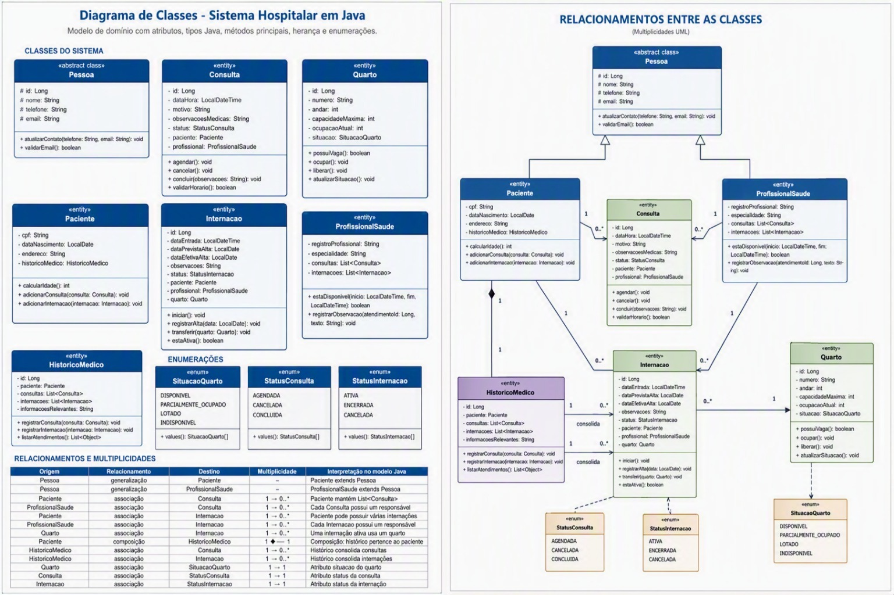

# Hospital Vida

Sistema de Gestão Hospitalar desenvolvido a partir de wireframes de alta fidelidade para centralizar o gerenciamento de pacientes, profissionais, consultas, internações, quartos e históricos clínicos.

> Este repositório contém o frontend do projeto. As telas são organizadas em pastas separadas por funcionalidade e devem ser conectadas por caminhos relativos.

## Sumário

- [Sobre o projeto](#sobre-o-projeto)
- [Funcionalidades](#funcionalidades)
- [Telas previstas](#telas-previstas)
- [Modelagem — Sprint 1](#modelagem--sprint-1)
  - [Diagrama de classes](#diagrama-de-classes)
  - [Relacionamentos e multiplicidades](#relacionamentos-e-multiplicidades)
  - [Cartões CRC](#cartões-crc)
- [Tecnologias utilizadas](#tecnologias-utilizadas)
- [Estrutura sugerida](#estrutura-sugerida)
- [Como executar](#como-executar)
- [Navegação entre as telas](#navegação-entre-as-telas)
- [Tela de histórico](#tela-de-histórico)
- [Integração com o backend](#integração-com-o-backend)
- [Boas práticas](#boas-práticas)
- [Próximos passos](#próximos-passos)

## Sobre o projeto

O **Hospital Vida** é uma interface web para apoio à gestão hospitalar. O sistema foi planejado para oferecer uma navegação simples entre os principais módulos administrativos e clínicos do hospital.

O frontend segue uma identidade visual consistente, com:

- menu lateral de navegação;
- barra superior de pesquisa e acesso ao usuário;
- conteúdo organizado em formulários, cartões e tabelas;
- layout adaptável para diferentes tamanhos de tela;
- separação entre estrutura, estilo e comportamento;
- preparação para integração posterior com uma API ou outro backend.

## Funcionalidades

O projeto contempla os seguintes módulos:

- autenticação de usuário;
- dashboard com indicadores gerais;
- listagem e cadastro de pacientes;
- listagem e cadastro de profissionais;
- listagem e agendamento de consultas;
- listagem e cadastro de internações;
- listagem e gerenciamento de quartos;
- consulta ao histórico do paciente;
- perfil e configurações do usuário;
- encerramento da sessão.

## Telas previstas

Com base nos wireframes do projeto, estão previstas as seguintes telas:

1. **Login**
2. **Início / Dashboard**
3. **Lista de pacientes**
4. **Cadastro de paciente**
5. **Lista de profissionais**
6. **Cadastro de profissional**
7. **Lista de consultas**
8. **Agendamento de consulta**
9. **Lista de internações**
10. **Lista de quartos**
11. **Histórico do paciente**
12. **Perfil / Configurações**

## Modelagem — Sprint 1

Na primeira sprint, o domínio do sistema foi modelado com um **diagrama de classes** e com **cartões CRC** (Classe – Responsabilidade – Colaboração). Os arquivos originais estão em [`docs/sprint1/`](docs/sprint1/).

> A evolução deste modelo na Sprint 2 (categorias de profissionais, modalidades de atendimento e novas situações da consulta) está documentada em [`backend/README.md`](backend/README.md) e em [`docs/diagrama-classes-sprint2.pdf`](docs/diagrama-classes-sprint2.pdf).

### Diagrama de classes



O modelo tem uma classe abstrata **`Pessoa`**, com os dados comuns (`id`, `nome`, `telefone`, `email`), da qual herdam **`Paciente`** e **`ProfissionalSaude`**. As demais entidades são **`Consulta`**, **`Internacao`**, **`Quarto`** e **`HistoricoMedico`**. As situações são representadas pelas enumerações:

| Enumeração | Valores |
|---|---|
| `StatusConsulta` | `AGENDADA`, `CANCELADA`, `CONCLUIDA` |
| `StatusInternacao` | `ATIVA`, `ENCERRADA`, `CANCELADA` |
| `SituacaoQuarto` | `DISPONIVEL`, `PARCIALMENTE_OCUPADO`, `LOTADO`, `INDISPONIVEL` |

### Relacionamentos e multiplicidades

| Origem | Relacionamento | Destino | Multiplicidade | Interpretação no modelo Java |
|---|---|---|---|---|
| Pessoa | generalização | Paciente | — | `Paciente extends Pessoa` |
| Pessoa | generalização | ProfissionalSaude | — | `ProfissionalSaude extends Pessoa` |
| Paciente | associação | Consulta | 1 → 0..* | Paciente mantém `List<Consulta>` |
| ProfissionalSaude | associação | Consulta | 1 → 0..* | Cada consulta possui um responsável |
| Paciente | associação | Internacao | 1 → 0..* | Paciente pode possuir várias internações |
| ProfissionalSaude | associação | Internacao | 1 → 0..* | Cada internação possui um responsável |
| Quarto | associação | Internacao | 1 → 0..* | Uma internação ativa usa um quarto |
| Paciente | composição | HistoricoMedico | 1 ◆— 1 | O histórico pertence ao paciente |
| HistoricoMedico | associação | Consulta | 1 → 0..* | O histórico consolida as consultas |
| HistoricoMedico | associação | Internacao | 1 → 0..* | O histórico consolida as internações |
| Quarto | associação | SituacaoQuarto | 1 → 1 | Atributo `situacao` do quarto |
| Consulta | associação | StatusConsulta | 1 → 1 | Atributo `status` da consulta |
| Internacao | associação | StatusInternacao | 1 → 1 | Atributo `status` da internação |

### Cartões CRC

Os cartões representam as principais partes do sistema, agrupados pelos casos de uso. O documento completo está em [`docs/sprint1/cartoes-crc-sprint1.pdf`](docs/sprint1/cartoes-crc-sprint1.pdf).

#### Caso de uso: Agendar Consulta

**Consulta**

| Responsabilidades | Colaborações |
|---|---|
| Conhecer seu paciente | Paciente |
| Conhecer seu profissional | Profissional |
| Conhecer sua data e horário | |
| Conhecer seu motivo e suas observações | |
| Conhecer seu status (Confirmada, Pendente ou Cancelada) | |
| Agendar-se | |
| Confirmar-se | |
| Cancelar-se | |

**Paciente**

| Responsabilidades | Colaborações |
|---|---|
| Conhecer seu nome | Consulta |
| Conhecer seu CPF | Internação |
| Conhecer sua data de nascimento | Histórico do Paciente |
| Conhecer seu telefone, endereço e e-mail | |
| Conhecer suas consultas | |
| Conhecer suas internações | |
| Conhecer seu histórico | |

**Profissional**

| Responsabilidades | Colaborações |
|---|---|
| Conhecer seu nome | Consulta |
| Conhecer seu registro profissional | Internação |
| Conhecer sua especialidade | |
| Conhecer seu telefone e e-mail | |
| Conhecer suas consultas | |
| Conhecer as internações pelas quais é responsável | |

#### Caso de uso: Realizar Internação

**Internação**

| Responsabilidades | Colaborações |
|---|---|
| Conhecer seu paciente | Paciente |
| Conhecer seu quarto | Quarto |
| Conhecer seu profissional responsável | Profissional |
| Conhecer sua data de entrada e sua data de alta | |
| Conhecer sua situação (Ativa ou Alta) | |
| Conhecer suas observações | |
| Registrar-se | |
| Dar-se alta | |

**Quarto**

| Responsabilidades | Colaborações |
|---|---|
| Conhecer seu número e seu andar | Internação |
| Conhecer seu tipo (Enfermaria ou UTI) | |
| Conhecer sua capacidade | |
| Conhecer sua situação (Ocupado ou Disponível) | |
| Conhecer suas internações | |
| Ocupar-se | |
| Liberar-se | |

#### Caso de uso: Consultar Histórico do Paciente

**Histórico do Paciente**

| Responsabilidades | Colaborações |
|---|---|
| Conhecer seu paciente | Paciente |
| Conhecer as consultas realizadas pelo paciente | Consulta |
| Conhecer as internações realizadas pelo paciente | Internação |
| Conhecer as informações relevantes registradas durante os atendimentos | |

#### Caso de uso: Acessar o Sistema

**Usuário**

| Responsabilidades | Colaborações |
|---|---|
| Conhecer seu nome | — |
| Conhecer seu e-mail | |
| Conhecer sua senha | |
| Conhecer seu perfil de acesso (Administrador, Recepcionista ou Profissional) | |
| Autenticar-se no sistema | |
| Alterar sua senha | |

## Tecnologias utilizadas

- **HTML5** para a estrutura das páginas;
- **CSS3** para estilização e responsividade;
- **JavaScript** para interações e atualização dinâmica da interface;
- **Git** para controle de versão;
- **GitHub** ou outro repositório Git para hospedagem e colaboração.

O frontend foi desenvolvido sem dependência obrigatória de frameworks ou bibliotecas externas.

## Estrutura sugerida

A estrutura abaixo mantém cada funcionalidade em uma pasta própria:

```text
hospital-vida/
├── README.md
│
├── login/
│   ├── login.html
│   ├── login.css
│   └── login.js
│
├── inicio/
│   ├── inicio.html
│   ├── inicio.css
│   └── inicio.js
│
├── pacientes/
│   ├── pacientes.html
│   ├── cadastrar-paciente.html
│   ├── pacientes.css
│   └── pacientes.js
│
├── profissionais/
│   ├── profissionais.html
│   ├── cadastrar-profissional.html
│   ├── profissionais.css
│   └── profissionais.js
│
├── consultas/
│   ├── consultas.html
│   ├── agendar-consulta.html
│   ├── consultas.css
│   └── consultas.js
│
├── internacoes/
│   ├── internacoes.html
│   ├── internacoes.css
│   └── internacoes.js
│
├── quartos/
│   ├── quartos.html
│   ├── quartos.css
│   └── quartos.js
│
├── historico/
│   ├── historico.html
│   ├── historico.css
│   └── historico.js
│
├── perfil/
│   ├── perfil.html
│   ├── perfil.css
│   └── perfil.js
│
└── assets/
    ├── imagens/
    ├── icones/
    └── fontes/
```

A estrutura real pode ser diferente. Caso os nomes das pastas ou arquivos sejam alterados, os caminhos presentes nos links também deverão ser atualizados.

## Como executar

### Opção 1: abrir diretamente no navegador

1. Faça o download ou clone o repositório.
2. Entre na pasta do projeto.
3. Abra o arquivo inicial, por exemplo `login/login.html` ou `inicio/inicio.html`.

### Opção 2: usar o Live Server

No Visual Studio Code:

1. instale a extensão **Live Server**;
2. clique com o botão direito no arquivo HTML inicial;
3. selecione **Open with Live Server**.

O Live Server é recomendado porque atualiza a página após alterações nos arquivos e reduz problemas durante o desenvolvimento local.

## Navegação entre as telas

Como as páginas estão separadas por funcionalidades, os links devem usar caminhos relativos à localização do HTML atual.

### Exemplo

Dentro de `historico/historico.html`, um link para a lista de pacientes pode ser escrito assim:

```html
<a href="../pacientes/pacientes.html">Pacientes</a>
```

Nesse caminho:

- `../` retorna da pasta `historico` para a raiz do projeto;
- `pacientes/` entra na pasta de pacientes;
- `pacientes.html` abre a página desejada.

Um exemplo de menu dentro da tela de histórico seria:

```html
<nav class="nav-list">
  <a href="../inicio/inicio.html">Início</a>
  <a href="../pacientes/pacientes.html">Pacientes</a>
  <a href="../profissionais/profissionais.html">Profissionais</a>
  <a href="../consultas/consultas.html">Consultas</a>
  <a href="../internacoes/internacoes.html">Internações</a>
  <a href="../quartos/quartos.html">Quartos</a>
  <a href="historico.html" aria-current="page">Histórico</a>
  <a href="../login/login.html">Sair</a>
</nav>
```

### Regras rápidas para os caminhos

- arquivo na mesma pasta: `pagina.html`;
- arquivo dentro de uma subpasta: `pasta/pagina.html`;
- arquivo em uma pasta paralela: `../outra-pasta/pagina.html`;
- arquivo dois níveis acima: `../../pagina.html`.

Evite espaços, acentos e letras maiúsculas nos nomes dos arquivos e diretórios. Prefira nomes como `cadastrar-paciente.html` e `historico-paciente.html`.

## Tela de histórico

A tela **Histórico do Paciente** apresenta:

- identificação do paciente;
- CPF;
- data de nascimento;
- consultas realizadas;
- profissional responsável por cada consulta;
- motivo e observações dos atendimentos;
- internações realizadas;
- datas de entrada e alta;
- quarto utilizado;
- informações complementares relevantes.

A implementação atual da tela inclui:

- pesquisa local por nome ou CPF;
- seleção entre pacientes de demonstração;
- atualização dinâmica das informações com JavaScript;
- tabelas de consultas e internações;
- mensagem para ausência de registros;
- botão para imprimir o histórico;
- menu lateral responsivo em telas menores;
- visualização em cartões no celular;
- HTML semântico e atributos básicos de acessibilidade.

Os pacientes e registros presentes no JavaScript são dados de demonstração. Eles deverão ser substituídos pelos dados retornados pelo backend.

## Integração com o backend

O frontend ainda pode ser conectado a uma API para carregar e salvar dados reais.

Exemplo genérico de leitura de um histórico:

```javascript
async function carregarHistorico(idPaciente) {
  const resposta = await fetch(`/api/pacientes/${idPaciente}/historico`);

  if (!resposta.ok) {
    throw new Error("Não foi possível carregar o histórico do paciente.");
  }

  const historico = await resposta.json();
  return historico;
}
```

Na integração, recomenda-se:

- remover os dados fictícios definidos diretamente no JavaScript;
- centralizar o endereço da API em um arquivo de configuração;
- exibir estados de carregamento, sucesso e erro;
- validar os dados no frontend e no backend;
- não armazenar senhas ou dados clínicos sensíveis no código-fonte;
- implementar autenticação e autorização por perfil;
- proteger os dados pessoais e clínicos tratados pelo sistema;
- usar HTTPS em ambientes publicados.

## Boas práticas

### Organização

- manter HTML, CSS e JavaScript bem separados;
- utilizar nomes de classes claros e consistentes;
- manter um padrão único de nomes para pastas e arquivos;
- evitar duplicação de estilos e funções;
- reutilizar componentes visuais sempre que possível.

### Acessibilidade

- associar `label` aos campos de formulário;
- utilizar textos alternativos em imagens relevantes;
- manter contraste adequado entre texto e fundo;
- permitir navegação por teclado;
- indicar visualmente a tela atual no menu;
- usar elementos HTML semânticos.

### Responsividade

- testar as telas em computador, tablet e celular;
- evitar larguras fixas que causem rolagem horizontal;
- adaptar tabelas para cartões ou blocos em telas pequenas;
- manter botões e campos confortáveis para interação por toque.

### Controle de versão

Utilize commits pequenos e descritivos. Exemplos seguindo o padrão Conventional Commits:

```text
feat: adiciona tela de histórico do paciente
feat: conecta navegação entre os módulos
fix: corrige caminho para a tela de consultas
style: ajusta responsividade do menu lateral
refactor: reorganiza dados dos pacientes no JavaScript
docs: adiciona documentação do projeto
```

## Próximos passos

- [ ] Conectar todas as páginas pelo menu lateral.
- [ ] Padronizar nomes de arquivos e diretórios.
- [ ] Centralizar cores, fontes e componentes compartilhados.
- [ ] Implementar as telas restantes conforme os wireframes.
- [ ] Substituir dados fictícios por dados da API.
- [ ] Implementar autenticação e encerramento real da sessão.
- [ ] Adicionar validação aos formulários.
- [ ] Exibir mensagens de carregamento, sucesso e erro.
- [ ] Testar a navegação em diferentes navegadores.
- [ ] Revisar acessibilidade e responsividade.
- [ ] Adicionar testes automatizados quando o projeto evoluir.

## Observações

Este README foi elaborado a partir dos wireframes e do frontend já desenvolvido para a tela de histórico. Ajuste nomes de arquivos, comandos, rotas e tecnologias caso a estrutura final do repositório seja diferente da estrutura sugerida neste documento.

## Autor

**João Pedro Fonseca Baião**
