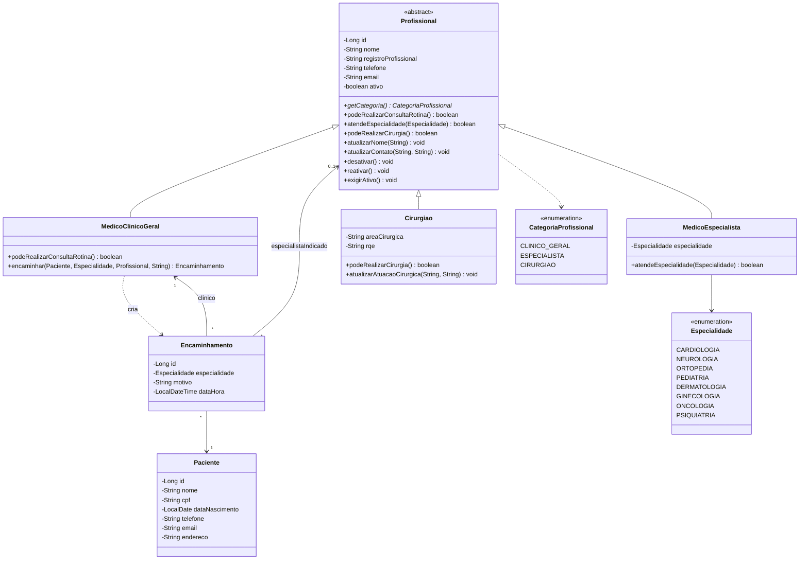
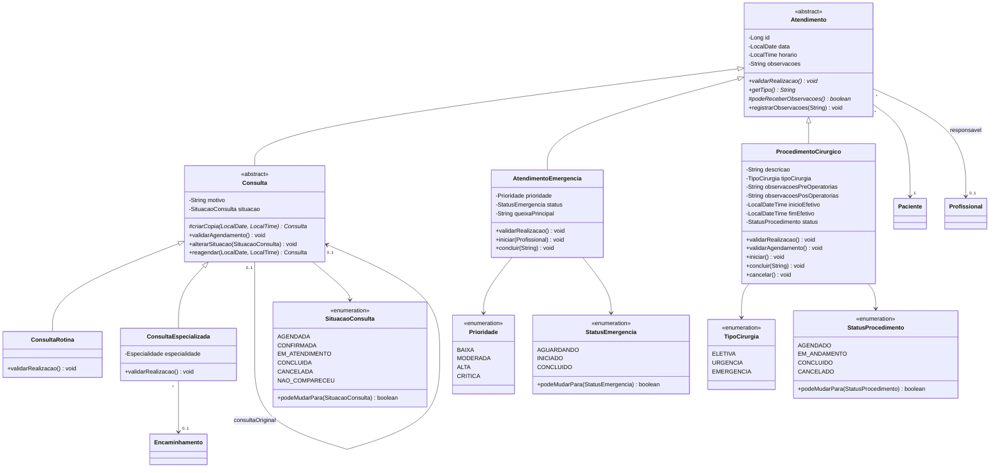
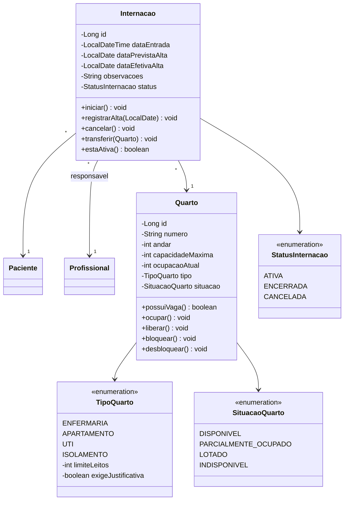

# Diagrama de Classes - Sprint 2

O GitHub renderiza os blocos Mermaid automaticamente; para exportar como imagem, use https://mermaid.live.
O modelo da Sprint 1 está em [`docs/sprint1/`](../../docs/sprint1/).

## Pessoas e profissionais

## Modalidades de atendimento

## Internações e quartos

