# Diagrama de Classes - Sprint 2

Ponto de partida gerado a partir do esqueleto. **Pessoa 1** mantém este diagrama atualizado
conforme as classes forem implementadas. O GitHub renderiza o bloco Mermaid abaixo
automaticamente; para exportar como imagem, use https://mermaid.live.

```mermaid
classDiagram
    direction TB

    class Paciente {
        -Long id
        -String nome
        -String cpf
        -LocalDate dataNascimento
        -String telefone
        -String email
        -String endereco
    }

    class Profissional {
        <<abstract>>
        -Long id
        -String nome
        -String registroProfissional
        -String telefone
        -String email
    }
    class MedicoClinicoGeral {
        +encaminhar(Paciente, Especialidade, String) ConsultaEspecializada
    }
    class MedicoEspecialista {
        -Especialidade especialidade
        +atendeEspecialidade(Especialidade) boolean
    }
    class Cirurgiao {
        -String areaCirurgica
    }
    Profissional <|-- MedicoClinicoGeral
    Profissional <|-- MedicoEspecialista
    Profissional <|-- Cirurgiao

    class Atendimento {
        <<abstract>>
        -Long id
        -LocalDate data
        -LocalTime horario
        -String observacoes
        +validarRealizacao()* void
        +registrarObservacoes(String) void
    }
    class Consulta {
        <<abstract>>
        -String motivo
        -SituacaoConsulta situacao
        +alterarSituacao(SituacaoConsulta) void
    }
    class ConsultaRotina
    class ConsultaEspecializada {
        -Especialidade especialidade
    }
    class AtendimentoEmergencia {
        -Prioridade prioridade
        -StatusEmergencia status
        +iniciar() void
        +concluir() void
    }
    class ProcedimentoCirurgico {
        -String descricaoProcedimento
        -String tipoCirurgia
        -String observacoesPreOperatorias
        -String observacoesPosOperatorias
        -LocalDateTime inicioEfetivo
        -LocalDateTime fimEfetivo
        -StatusProcedimento status
        +iniciar() void
        +concluir() void
        +cancelar() void
    }
    Atendimento <|-- Consulta
    Consulta <|-- ConsultaRotina
    Consulta <|-- ConsultaEspecializada
    Atendimento <|-- AtendimentoEmergencia
    Atendimento <|-- ProcedimentoCirurgico
    Atendimento "*" --> "1" Paciente
    Atendimento "*" --> "0..1" Profissional

    class Quarto {
        -Long id
        -String numero
        -TipoQuarto tipo
        -int capacidade
        -int leitosOcupados
        +temLeitoDisponivel() boolean
        +ocuparLeito() void
        +liberarLeito() void
    }
    class Internacao {
        -Long id
        -LocalDate dataEntrada
        -LocalDate dataAlta
        -String motivo
        -String observacoes
        +isAtiva() boolean
        +darAlta(LocalDate) void
    }
    Internacao "*" --> "1" Paciente
    Internacao "*" --> "1" Quarto
    Internacao "*" --> "1" Profissional : responsável

    class SituacaoConsulta {
        <<enumeration>>
        AGENDADA
        CONFIRMADA
        EM_ATENDIMENTO
        CONCLUIDA
        CANCELADA
        NAO_COMPARECEU
    }
    class Prioridade {
        <<enumeration>>
        BAIXA
        MODERADA
        ALTA
        CRITICA
    }
    class StatusEmergencia {
        <<enumeration>>
        AGUARDANDO_AVALIACAO
        INICIADO
        CONCLUIDO
    }
    class StatusProcedimento {
        <<enumeration>>
        AGENDADO
        EM_ANDAMENTO
        CONCLUIDO
        CANCELADO
    }
    class Especialidade {
        <<enumeration>>
        CARDIOLOGIA
        NEUROLOGIA
        ORTOPEDIA
    }
    class TipoQuarto {
        <<enumeration>>
        ENFERMARIA
        APARTAMENTO
        UTI
    }
```

