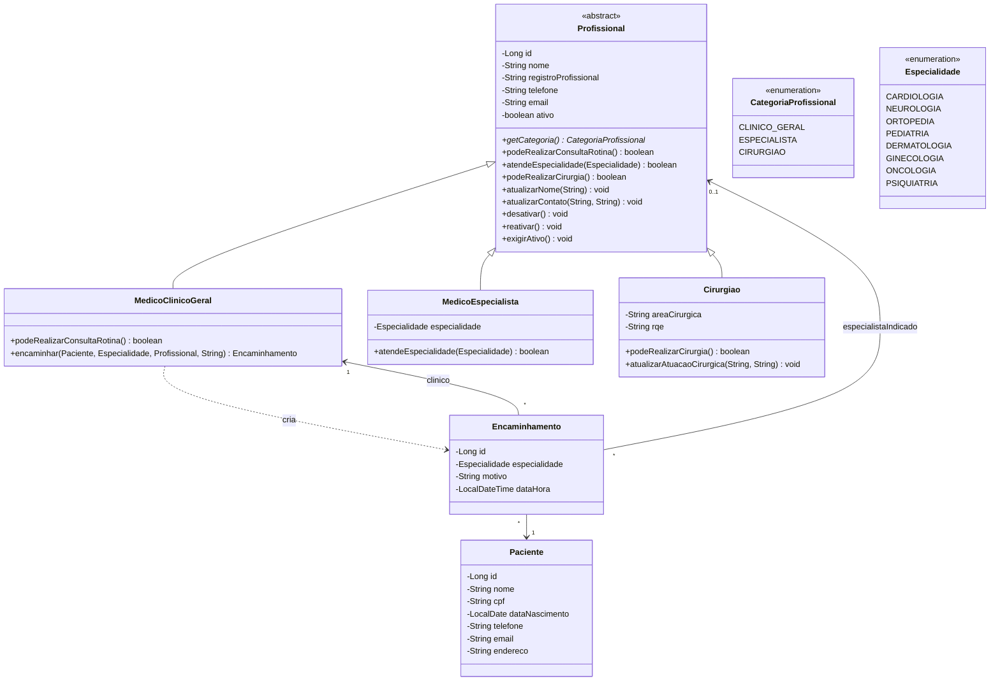
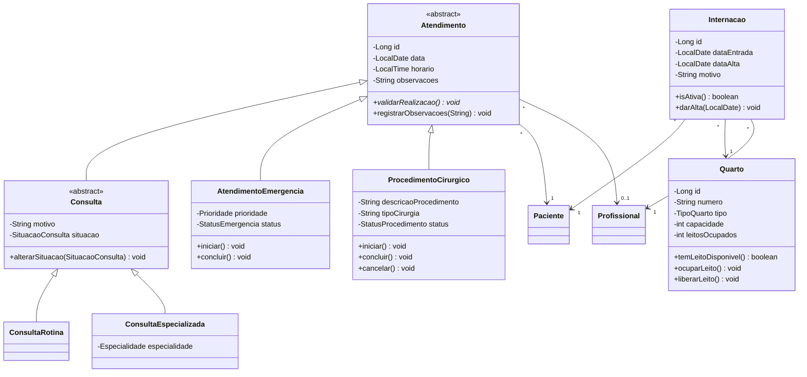

# Diagrama de Classes - Sprint 2

Mantido pela **Pessoa 1**. O GitHub renderiza o bloco Mermaid automaticamente; para exportar como
imagem, use https://mermaid.live.

| Parte | Situação |
|---|---|
| Pessoa 1 - Paciente | implementado |
| Pessoa 2 - Profissionais e encaminhamentos | implementado (branch `daniell`) |
| Pessoa 3 - Consultas e emergências | **previsto**, atualizar quando a branch chegar |
| Pessoa 4 - Procedimento cirúrgico, internações e quartos | **previsto**, atualizar quando a branch chegar |

## Implementado

## Previsto (Pessoas 3 e 4)

Proposta inicial; será substituída pelas classes reais quando as branches forem integradas.

